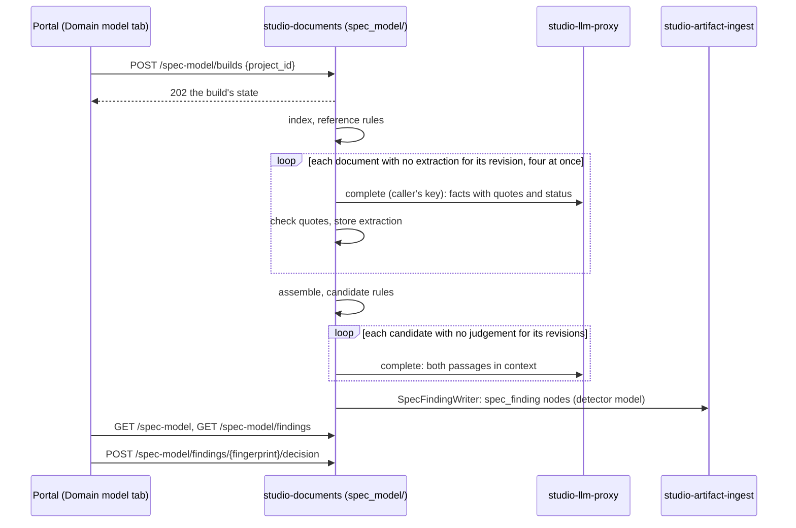

# A project's domain model, read from its documents

What Studio reads out of a project's documentation about the application it
describes, how it finds where the documents disagree about it, and where that
lives in the code.

Status: proposal, 2026-10-12. It is part of
[studio-documents](design/studio-documents.md), the gear that already owns the
document index, the analysis on sync and the findings, as the module
`studio-backend/src/documents/spec_model/`. Requirements:
`cpt-studio-fr-spec-domain-model` and `cpt-studio-fr-spec-contradictions` in the
[PRD](prd/constructor-studio.md).

## Why this exists

A project's documentation describes an application that does not exist yet.
Spread over its PRDs, designs, decompositions and ADRs is that application's
domain model: what it is made of (entities, their attributes and relations),
what it has to do (requirements) and what must always hold (constraints,
lifecycles, access rules, decisions). Nobody writes this model down in one
place, so nobody sees where the documents disagree about it, and a
disagreement is found when someone builds one side of it.

Studio reads the model out of the documents as they are written and keeps it
per project, every fact with the passage it comes from and whether that passage
is in force. Then it checks the model for the problems a person would want to
fix: two documents that cannot both be right, a document still describing what
a later decision replaced, a reference to something that does not exist. Each
problem is a finding with both passages, an explanation and the smallest edit
that fixes it, or the decision a person has to take when the documents cannot
tell which side is right.

The goal is not a better-written specification. Judging a document's form is
the Spec Quality detectors' job ([spec-findings.md](spec-findings.md)). This
finds precise, fixable disagreements about the product, and stays quiet about
everything else.

## Principles

**Read as written, fix what is wrong.** Building the model asks nothing of the
documents: no front matter, no template, no annotations
(`cpt-studio-principle-spec-mapping-as-written`). The same mechanism runs on
every project; nothing in the prompts, rules or code names a product, a
repository, a document path or a domain term. What it proposes to change is
only what is wrong about the product, each in one edit: never a missing
section, a style, or "could be clearer".

**Every fact has a passage and a status.** A fact without its passage cannot be
argued with, and a fact without its status makes every deferred section look
like a contradiction. So every fact carries:
- **where**: path, line range and the verbatim quote. The quote is checked
  mechanically against the document revision it was extracted from; a quote
  not found there, whitespace collapsed, drops the fact;
- **status**: `active`; `proposed` (from a proposed ADR with no sign of being
  built, or a requirement the text marks as such); `deferred` ("future",
  "planned", "out of this release", "known gap"); `superseded` (the text, or a
  later decision, says it was replaced); `resolved` (an open question the text
  closes elsewhere); or `evidence` (research notes, audits, examples, an ADR's
  Context, a component's "why it exists": what someone found or what was
  true before, not what the product must do). The words that gave the status
  are kept with it.

Status belongs to a clause, not a block: "Planned. … returns nothing today"
holds a deferred plan and an active statement about now. And a proposed ADR is
not always unbuilt: a team may leave records `proposed` after shipping them,
so an ADR whose own text says "Built", "Implemented in" or "done in #N" counts
as in force for those parts. Supersession is read from the later record
("Supersedes", "Amends", "retired by"), not from an index's status column,
which drifts.

A finding is only ever raised between `active` facts, or between an `active`
fact and the `active` decision that replaced it.

**The model is the unit, not the document.** Most of what is worth finding sits
on a seam between documents: the domain's PRD against a component's design, an
ADR against the design that cites it, a decomposition against the PRD it
decomposes. A check that reads one document cannot see them. So facts are
merged across the project before any rule runs: one entity mentioned in five
documents is one entity with five sources, and two statements about the same
aspect of it are compared wherever they are.

**Rules propose, a model confirms, a person decides.** Finding a candidate is
deterministic: two `active` facts on the same entity and aspect with different
values; an `active` statement that a `proposed` decision is in force; an
identifier referenced and defined nowhere. A candidate becomes a finding only
when the judge, shown both passages with their surrounding section, agrees they
cannot both hold, says why in a sentence or two and proposes the fix. A member
then marks the finding ✓ (a real problem) or ✗ (not one); the decision is kept
for as long as the finding keeps appearing.

**Quiet beats complete.** A finding a reviewer dismisses costs more than a
finding never raised, because it teaches people to ignore the list. Rules that
produced noise on real documentation are not run (see
[the catalogue](#the-rule-catalogue)), and a rule joins the catalogue only after
it has been calibrated on at least two unrelated projects.

## Constraints

**A person's key, never Studio's.** Extraction and judging call a model through
`llm_proxy::port::ModelProviders::complete` on the key of the member who
started the build (ADR-0039): Studio holds no key of its own. A source sync
therefore refreshes only the deterministic index and marks the model stale; the
model calls run when a member builds it. A member with no key is told so, and
the index's findings (references) are still shown.

**Results are tied to revisions.** Model answers are not deterministic. An
extraction is stored per (project, path, content revision, extractor version)
and a judgement per (rule, fingerprint, the revisions of every side, judge
version). An unchanged document is never extracted again, so the model does not
change between two builds of the same text, and a finding missing from a
rebuild is resolved only when the text of one of its sides changed.

## The model

- **Source document**: a typed document of the project (repository binding or
  Studio document), with its kind (`spec` or `evidence`), its path and its
  content revision, as the documents index already holds it. Typed means a
  person settled the type in the Specs tab -- confirmed a proposal or chose
  one, the Bound queue. A file a detector only guessed at waits in Needs
  review and is not read: the Specs tab decides what the project's
  documentation is, and the model is read from that.
- **Reference index**: every identifier the project's documents define and
  where (a requirement or component id, a heading anchor, an ADR); every
  reference to one; every link. ADRs are indexed with their **namespace** (the
  directory they live in), number, title and status, read from front matter, a
  `Status:` line or an inline note, because one project can number two ADR sets
  from 0001.
- **Fact**: `{kind, subject, aspect?, value?, text, status, status_because?,
  sources[]}`, with `kind` one of `entity`, `attribute`, `relation`,
  `requirement`, `constraint`, `lifecycle`, `decision`. `subject` is the entity
  (or decision) it is about; `aspect` is the slot a value fills, named by the
  extractor in plain words (grain, trigger, dating rule, routing, cardinality,
  who may read, limit). Every source is `{path, line_start, line_end, quote,
  revision}`.
- **Entity**: a merged subject: its name, its aliases, its definition and the
  facts about it. Implicit entities count: a thing never declared but used as a
  key or a grain ("one row per connector instance") is an entity.
- **Candidate**: a rule, the facts on its sides, and its fingerprint (the rule
  and every side's path and normalised quote; never line numbers).
- **Finding**: the shape the spec-findings pipeline already reads
  ([the finding](spec-findings.md#the-finding)) with `detector: "model"`:
  `rule`, `severity`, `message` (the judge's explanation), `anchor` (side A),
  `related` (the other sides), `fix` (`{path, replace, with}` or `{decide: [A,
  B]}`), `confidence`.
- **Finding decision**: (project, fingerprint) → `confirmed` or `dismissed`,
  with who, when and the revisions decided against.

## A build

One build, in this process, under the security context of the member who
started it. Not a studio-tasks run: the queue worker acts as `studio-tasks`
and never as the person who asked (`tasks/dispatch.rs`), and a model is
reached only on a person's key. Losing a build to a restart costs little,
because every document finished is kept by revision and the next build starts
where this one stopped. Its stages:

1. **Index** (no model). Lists the project's typed documents and their
   revisions; builds the reference index; runs the reference rules.
2. **Extract** (model, per changed document). Reads a document section by
   section and asks for its facts in the schema above, with status and
   verbatim quotes; checks every quote; stores the extraction for that
   revision. The prompt is the same for every project.
3. **Assemble** (no model). Merges subjects by normalised name and aliases
   across documents; applies decision status (a fact resting on a proposed ADR
   with no sign of being built is `proposed`; a superseded ADR's facts are
   `superseded`); groups facts by (subject, aspect).
4. **Candidates** (no model). Runs the rules of the catalogue over the
   assembled model.
5. **Judge** (model, per new candidate). Shows both passages with their whole
   section and both documents' status notes; keeps the candidate only on a
   confirmed conflict, with the explanation and the fix; stores the judgement
   for those revisions.
6. **Record.** Writes the findings as `spec_finding` nodes through
   `artifact_ingest::port::SpecFindingWriter` (one per document with findings,
   other sides in `related`), so the Specs list counts them and the IDE's
   Quality rail shows them in the text.

In the code, under `studio-backend/src/documents/spec_model/`: `index.rs`,
`extract.rs`, `rules.rs` (assembly and candidates), `judge.rs` and
`record.rs` (stage 6), all pure but for the model calls `build.rs` makes;
`build.rs` for the run; the routes in the gear's `rest.rs`. The text is read through `artifact_ingest::port::RepoFileReader`, as
classification already reads it.

**Built so far: stages 3 to 5, and ✓/✗.** `rules.rs` merges the facts by
subject and aspect (case, articles, punctuation and a plural `s` folded) and
proposes a candidate for each pair of different `active` values of one slot,
not for each pair of passages, and a `stale.superseded` candidate where
`active` text gives the very value another passage says was replaced; at most
150 per build, the ones across documents first. `judge.rs` shows the judge
both passages with 25 lines around each and the headings above, and keeps a
finding only on a confirmed conflict that is not low-confidence; its edit only
when the text it replaces is in the document it names. A judgement is kept per
(fingerprint, the sides' revisions, judge version) in
`studio_spec_model_judgements` (`m0016`), so a candidate is judged once until
one of its documents changes. A finding the judge worded is fingerprinted by
its passages alone. `POST /spec-model/findings/{fingerprint}/decision` keeps a
member's `confirmed` or `dismissed` in `studio_spec_model_decisions`, and
`GET /spec-model/findings` answers it with each finding.

**The last two rules and the record.** `contradiction.decision` is proposed
where a pair of values has a decision on one side (the decision is side B,
the text that answers to it side A), and where `active` text in another
document gives the very value only a `proposed` decision gives.
`reference.misattributed` needs no facts: `index.rs` takes each line that
cites exactly one record (a bare number resolved to the nearest record set,
or a link to the record's file), says at least three words of its own, and
shares none of them with the record's title, at most 50 a build; the judge
then sees the record's first lines and its Decision section, not its Context.
On this repository's peer corpus that is 19 citations out of 267 documents,
most of them connector documents citing an ADR number only another
component's record set has. The judge's question names the rule's own
suspicion (`JUDGE_VERSION` 2). At the end of a build, `record.rs` writes one
`spec_finding` verdict per document under the detector `spec_model`: the
findings whose first side is in it, the other sides as `related`, in the
`/verdicts` shape; `clean` for a document with none, which clears what an
earlier build recorded; a dismissed finding is left out. A ✓ or ✗ given
after the build reaches the IDE at the next build.

**Stage 2.** `extract.rs` cuts a document at its top-level
headings into pieces of at most 12,000 characters, numbers every line, and asks
for the facts as JSON; `read_answer` keeps a fact only when its quote is in the
text (markup and whitespace aside), within two lines of where the model said
or else anywhere in the piece, and moves it to the lines it is really on.
`build.rs` reads the documents not read at their revision, asks an unreadable
piece once more, keeps a piece that fails twice as the document's `error` (read
again on the next build), and stops when the caller has no key. Kept in
`studio_spec_model_extractions` (`m0015`). Up to four documents are read at
once (`PARALLEL_READS`); each extraction is kept on its own, so the order they
finish in changes nothing. `POST /spec-model/builds` starts it (with `path`, it
reads that one document again and replaces only its facts), and
`GET /spec-model/build-estimate?project_id=` says beforehand how many documents
it would read, their approximate input tokens, and how long it should take at
the pace of the earlier builds;
`GET /spec-model` answers the facts of the current revisions, each document's
state, and the build's progress as the replica answering knows it.

**Stage 1.** `index.rs` and `finding.rs`, served by
`GET /spec-model/findings?project_id=`, computed on read (it is cheap and needs
no key). The reference rules, as built:
- an identifier is checked only in a family (the first two segments, as in `cpt-…`) the project defines
  at least five of, with the kit's defining labels `**ID**:` and `**Contract**:`;
- an ADR number is checked only when the project has ADRs, and resolved to the
  nearest ADR directory; a tie is `reference.ambiguous`;
- a link is checked against every file of the project's checkouts, and an
  anchor against the target's headings and explicit ids, compared with
  everything but letters and digits removed, because renderers slug headings
  differently and a link is not broken on the renderer it was written for;
- a line naming what something used to be called ("formerly", "renamed") is
  history and is not resolved;
- one missing thing is one finding with every place that cites it, and its
  fingerprint is the thing alone.

## The rule catalogue

Calibrated on real documentation ([calibration](#calibration)). **Run:**

| Rule | Finds | Stage | Severity |
|---|---|---|---|
| `reference.dangling` | An identifier, ADR or file referenced and defined nowhere in the project | index | high |
| `reference.ambiguous` | A bare ADR number that two namespaces of the project both have, cited from outside both | index | medium |
| `reference.misattributed` | A citation whose stated purpose does not match the cited ADR's title and decision | judge | high |
| `contradiction.value` | Two `active` facts give one aspect of one subject different values (an enum, a number, a routing, a shape, a percentile), including a stated count against the list it counts ("five tables" beside six); only an explicit count or a closed list, never "used by" or a parenthetical example | rules + judge | high |
| `contradiction.cardinality` | One row or object per A in one place, per B in another | rules + judge | high |
| `contradiction.lifecycle` | Who or what starts, dates, ends or re-runs something, stated two ways | rules + judge | high |
| `contradiction.access` | Who may read or write, or whether a check runs, stated two ways | rules + judge | high |
| `contradiction.decision` | Text against an `active` decision, or text treating as made a `proposed` decision with no sign of being built | rules + judge | high |
| `stale.superseded` | `active` text describing what a later decision or section replaced | rules + judge | medium, marked "check" |

**Not run**, and why:
- `term.synonym_drift`: every candidate in calibration was a deliberate rename
  between layers, except an identifier used for two things, which
  `reference.ambiguous` already catches;
- `term.undefined`, `requirement.orphan`, `constraint.vague`: nothing they
  raised survived review;
- `formula.mismatch`: real, but needs a table of what each quantity is called
  in each layer first; a later rule.

## REST

Under `/studio-documents/v1`, beside the gear's other routes:

| Method | Path | Description |
|--------|------|-------------|
| `POST` | `/spec-model/builds` | Build a project's model on the caller's key: `202` with the `task_run` to follow |
| `GET` | `/spec-model/build-estimate?project_id=` | What a build would read now (or with `path`, one document), its approximate input tokens and seconds |
| `GET` | `/spec-model?project_id=` | The assembled model: entities with their facts and sources, requirements, constraints, decisions; whether it is stale and which documents are not extracted yet |
| `GET` | `/spec-model/findings?project_id=` | The findings with their sides, fix and decision, filterable by `rule` and `status` |
| `POST` | `/spec-model/findings/{fingerprint}/decision` | ✓ or ✗ on a finding; `201` with the decision |
| `GET` | `/spec-model/glossary?project_id=` | The project's glossary: one entry per subject, its name and its aliases ([the project's words](project-and-product.md#the-projects-words)) |
| `GET` | `/spec-model/reviews?project_id=` | Every accept or reject members gave on the facts the model read, by the key the tab gives a fact (kind, subject, aspect and the folded quote, hashed) |
| `POST` | `/spec-model/reviews` | Accept, reject, or put back as `proposed`, a selection of up to 500 facts in one action. A rejected reading leaves the model and is not proposed again while its passage says the same. Prefixed keys carry the project's other decisions: `ev:` evidence, `hyp:` a hypothesis's check, `ob:` an excluded obligation, `rel:` a match across projects, `iss:` an opened issue, `pri:` an item being prioritised, `prc:` a confirmed order |
| `POST` | `/spec-model/files/proposals` | A whole Markdown document under `docs/` as a pull request: the need a member accepted (`docs/discovery.md`), a confirmed prioritisation (`docs/priorities.md`), the hypotheses and their checks (`docs/hypotheses.md`); `201` with the pull request |
| `GET` | `/spec-model/check-methods?project_id=&kits=` | The hypothesis check methods the named kits add, each read from `.cf-studio/config/kits/<kit>/check-methods.json`; a kit whose file is out of shape is listed in `unread` with the reason |
| `POST` | `/spec-model/glossary/distinct` | Two entries are different things: kept on both as `distinct_from`, so they are not offered as one thing again; `204` |
| `POST` | `/spec-model/glossary/decisions` | Name an entry, or make it an alias of another; `201` with the decision |
| `POST` | `/spec-model/glossary/proposals?project_id=` | Rename `from` to `to` in the documents' prose (whole words, first letter's case kept; code, links and front matter untouched) as one pull request; `201` with the files and the pull request, `400` when no document uses `from` |
| `POST` | `/spec-model/sentences/proposals?project_id=` | Add one sentence to one of the project's documents, as a paragraph after the block line `line` is in, on the `revision` the model read, as a pull request: how the Domain model tab states a relation no document states and how the Glossary tells two words apart; `201` with the pull request, `400` when the file is not documentation, changed since it was read, or the line is blank or code |
| `GET` | `/spec-model/work?project_id=` | The identifiers the documents define with a label, with the synced issues, pull requests and commits that name them ([the links](project-and-product.md#the-links)) |
| `GET` | `/spec-model/requirements?project_id=` | Every labelled requirement with its statement and the basis its block states ([below](#requirements-and-their-basis)) |
| `GET` | `/spec-model/decisions?project_id=` | Every ✓/✗ recorded on the project's findings, the model's and the Spec Quality detectors' alike |

Every list answers `{items, total}`. A project the caller cannot reach answers
404.

## Requirements and their basis

`requirements.rs`, served by `GET /spec-model/requirements` and shown in the
Domain model tab's Requirements view. Asked for by the September 2026
interviews (problem 1.4: "the model invents content", raised by ten people in
five companies, High at all three scored companies): a reader wants to see
which requirements rest on something and which do not.

A requirement is whatever the documents define with a label, read as written.
Its **block** is the lines after the label up to the next heading or label.
Its **basis** is what that block itself states, strongest doubt first:

- `open_question`: "TBD", "open question", "to be decided", or a sentence of
  the statement ending in `?`;
- `assumption`: "assum…", "presum…", "hypothes…", "we believe",
  "unconfirmed";
- `cited`: a link, an ADR, an issue or pull request (`#12`), a labelled
  source (`**Source**:`, `**Evidence**:`), or an identifier another document
  defines (one the same document defines, like its own actors, is not a
  source);
- `reasoned`: a rationale (`**Rationale**:`, `**Why**:`) and no citation;
- `stated`: nothing about where it comes from.

The words that made it an assumption or an open question are kept as
`because`. Nothing here is a finding: `requirement.orphan` did not survive
calibration, and a requirement with no stated basis is not wrong, only
unsupported on the page. The list also carries how much synced work names each
identifier, so "defined and never worked on" is one filter away.

## Across projects

`related.rs`, served by `GET /spec-model/related` (issue #733; interview
problem 1.2, eighteen people in six companies). The rules above find
disagreements inside one project. This compares every requirement of the
project with those of the organization's other projects the caller can read
(at most 40 a call): a pair that shares most of its meaningful words is `same`
(three quarters or more) or `overlap` (from 45%), and `opposite` when one of
them negates what the other requires ("must not", "never", "without").
Deterministic and stored nowhere: a list of pairs to read side by side, never a
finding. No model judges these pairs: the words above are the whole rule. A
judge is future work, the same as for the rules that need a model key.

## From requirement to code and test

`trace.rs`, served by `GET /spec-model/trace` (issue #738). For every
requirement: the other documents that refer to it, and the code and test files
of the project's checkouts that name its identifier as a whole token, a test
told from code by its path (`tests/`, `_test.go`, `.spec.ts`, …). What is not
named is not traced; the view's filters are the gaps: not in code, not in a
test, named nowhere. Read with `GET /spec-model/work` (issues, pull requests,
commits), it is the impact of changing a requirement.

## Questions while writing

`questions.rs`, served by `GET /spec-model/questions?path=`,
`GET /spec-model/term-drift?path=` and `GET /spec-model/experts?subject=`
(issue #737; interview problem 1.3). For one
document: the glossary entries the project's other documents relate to an
entry this document names (a fact about one whose value or passage names the
other), which this document never mentions — the ledger a billing PRD forgot —
strongest first, at most 15; and every merged alias it uses where the project
chose another name. From the facts already extracted, so only after a build.
Whom to ask about an entity: the people who changed the three documents with
the most facts about it, from the repository history, bots left out.

## Tables

- `studio_spec_model_extractions`: `project_id`, `path`, `revision`,
  `extractor_version`, `facts jsonb`, `dropped` (facts whose quote failed),
  `created_at`; unique on the first four.
- `studio_spec_model_judgements`: `project_id`, `fingerprint`, `revisions`
  (sorted, one per side), `judge_version`, `verdict` (`conflict` or `none`),
  `finding jsonb`, `created_at`; unique on the first four.
- `studio_spec_model_decisions`: `project_id`, `fingerprint`, `decision`
  (`confirmed` or `dismissed`), `decided_by`, `decided_at`, `revisions`.
- `studio_spec_model_terms`: `project_id`, `term_key` (a subject folded),
  `name` (the chosen name, or null), `alias_of` (another entry's key, or
  null), `distinct_from` (the keys of entries a member said are different
  things, as a JSON array), `decided_by`, `decided_at`; unique on the first
  two.
- `studio_spec_model_reviews`: `project_id`, `fact_key`, `state` (`accepted`
  or `rejected`), `path` and `revision` where it was read, `decided_by`,
  `decided_at`; unique on the first two.

The assembled model is not stored: it is computed from the extractions of the
documents' current revisions, which is cheap and never stale. Members' reviews
lie over it: a rejected reading is left out, an accepted one is the project's
reading, everything else is what the model proposes.

## What stops a build

Only what a rule established or a person confirmed: a dangling reference, a
possible conflict a member said is a real problem, an open question. A
contradiction the judge reads from facts nobody confirmed is a *possible
conflict* — a concern to look at, not a verdict — until a member decides. An
assumption waiting for its check, and a requirement that names no source, are
listed to look at and stop nothing: a hypothesis is checked later, and a
citation says where a requirement comes from, not that it is proven. A trace
from a requirement to the code or a test is a name found there, never a claim
that it is covered.

## The Domain model tab

A project tab beside Specs and Components in the prototype
(`studio-frontend-prototype`), with three views:

- **Problems** (first, since it is what a person acts on): undecided before
  confirmed before dismissed, high first, disagreements before references.
  Each shows both passages side by side, the explanation, the proposed edit
  (or the decision to take), ✓/✗, and "open in the editor" at either side.
- **Entities**: a filterable list, and the entities each one relates to.
  Opening one shows its definition, attributes, relations, constraints,
  lifecycle and the requirements about it, each with "where it is said" (the
  passage, as a link into the document) and its status. Facts that are not
  `active` are shown greyed, with the words that made them so. A graph of the
  relations is later.
- **Documents**: which documents are extracted at their current revision,
  which are stale, failed or never read, and how many facts each gave and
  how many were dropped.

The Build button sits above all three and says what a running build is doing.

## The need, hypotheses, behaviour and priorities

Read off the same facts, for the PM workflow the PRDs *Describe the need*,
*Validate product hypotheses*, *Define the domain model and behaviour* and
*Prioritise functionality* describe. The extractor (version 2) also reads
`role`, `action`, `problem`, `outcome`, `idea`, `benefit` and `scenario`; the
last five describe the need, not a thing the application keeps, and stay off
the model map.

- **Materials.** A pasted interview, request or report, or a text file
  dropped in (Markdown, plain text, CSV, HTML, e-mail, subtitles; at most
  512 KiB each, one material per file), is a Studio document of the built-in
  `material` type (Source, Material). Anything else — a PDF, a Word file — is
  refused with the reason, never read as garbage. A project's Studio-held
  documents are read beside its repository files, under `studio:<id>`, and a
  material is read as soon as it is added, on the key of whoever added it:
  their own, else an AI connection they reach (personal, workspace,
  organization). When none answers, the reading stops and the Needs view says
  why beside the intake.
- **Needs** groups problems, outcomes, ideas and scenarios by role and shows
  the gaps — a problem nothing proposes to solve, an idea that names no
  problem — without filling them in. What a member accepted is proposed as
  `docs/discovery.md`.
- **Hypotheses**: each expected benefit is a claim (solution, for whom,
  effect), with a proposed check among the five methods (problem evidence,
  expected benefit, time/TCO, demand, existing capability) and one of four
  states — not checked, supports, contradicts, insufficient — kept as a
  review keyed `ev:`. Accepting the wording is not validating it, and an
  unchecked hypothesis stops nothing. Its **check** is an object of its own,
  kept beside it as a review keyed `hyp:` (state `check`, a JSON note of up
  to 8000 bytes): the methods chosen, when (research among available
  materials, an experiment with people, after implementation), a brief
  Studio proposes and the member edits, the criterion to read a result by
  (left empty, a result stays exploratory) and what checking found. The
  methods are a catalogue: the five built in, each with the uncertainty it
  addresses, its inputs, its action and its limits, then any a kit installed
  in the project adds through `.cf-studio/config/kits/<kit>/check-methods.json`
  (a JSON array of `id`, `label`, `uncertainty`, `inputs`, `action`,
  `limits`, `applies_to`), proposed for a claim whose words it names. The
  hypotheses, where they stand and how they are checked are proposed as
  `docs/hypotheses.md` for reading; the records stay the source. Priorities
  reads them: a requirement whose title or text names a hypothesis's solution
  gets its first Confidence from what checking found — supports the effect
  5, supports only a problem, demand or capability 3, contradicts or too
  little 1, both ways unresolved — shown beside the score.
- **Behaviour**: for each action a role takes on a thing and each state the
  thing goes through, whether it may happen then. A passage that names both
  answers it; otherwise it is asked, or excluded with a reason kept as a
  review keyed `ob:`. Above the questions: each action, and each scenario
  whose steps take one, that a permission rule a member accepted forbids to
  that role as written ("only owners may delete a project", yet a viewer
  deletes it), with both passages. Deterministic, and only over accepted
  rules; a passage that names no role is not judged.
- **Priorities**: ICE, the mean of Impact, Confidence and Ease, each 1–10;
  Ease from person-weeks by the PRD's bands, Confidence first proposed from a
  requirement's basis (an assumption 1, a citation 3, no basis unknown). Every
  value shows its origin, an unknown leaves the score incomplete, a tie stays a
  tie, and a prerequisite comes before what needs it while a cycle is shown.
  The working set is the project's, shared by everyone who opens it: each
  item compared is a review keyed `pri:` (state `scored`) whose note keeps
  what was entered. A confirmed order is proposed as `docs/priorities.md` and
  recorded keyed `prc:` (state `confirmed`) with the pull request and the
  order, so the view says whether the order changed since it was confirmed
  last and lists every confirmation. A comparison an earlier version kept in
  one browser is brought into the project only when someone asks.
- **Elsewhere**: a pair with another project's requirement is decided —
  reuse, coordinate, keep separate, unrelated — and kept, keyed `rel:`.

## Calibration

The catalogue comes from a manual run of this pipeline on 2026-10-12 over two
unrelated parts of a real repository written by another team,
constructorfabric/insight at 9f9e073: 24 documents (7,848 lines) of one domain
and 10 documents (5,110 lines) of another. Every quote was checked by script
and every finding re-read in context.

| | Part 1 | Part 2 |
|---|---|---|
| Facts extracted | 125 | 127 |
| Findings confirmed | 25 | 19 |
| Needed more than one document | 18 | 12 |
| Dropped as weak before review | about 6 | 5 |

Examples of what it found: a component design minting records for accounts the
domain PRD says **MUST** be skipped; a job started by an operator in one PRD and
by every pipeline plus a 15-minute schedule in the domain design; a snapshot
dated at the first of its month in a design and at its last read in the
decomposition; one row per connector in a PRD and one per connector instance in
the design; a `proposed` ADR cited by three documents as decided.

What made extraction hard, and what the design answers it with:
- Deferral is written in prose ("future", "resolved since", "out of this
  release"), not in ADR chains: hence the status on every fact.
- Entities are often implicit (a grain, a key, a row kind): hence implicit
  entities in the extraction schema.
- One fact appears in a column table, a routing table, a list of steps and an
  ADR, and they disagree: hence merging by subject and aspect.
- Two ADR sets number from 0001: hence ADR namespaces in the index.

**The second calibration**, the same day, on this repository's own
specifications (24 documents, about 11,400 lines: the PRD, the product design
and decomposition, eight gear designs, the ADRs from 0030): 70 facts, 14
findings confirmed against 45 candidates rejected.

| Rule | Confirmed / candidates | Verdict |
|---|---|---|
| `contradiction.value` | 7 / 21 | precise once a count must be explicit |
| `stale.superseded` | 3 / 6 | precise |
| `contradiction.access` | 1 / 4 | precise |
| `contradiction.decision` | 2 / about 70 | noisy until built-but-proposed ADRs count as in force |
| `reference.dangling` | 1 / 7 | precise when paths resolve from the component described |
| `reference.misattributed`, `.ambiguous`, `contradiction.cardinality`, `.lifecycle` | 0 | quiet: no false positives |

What it found: the product design still sending the IDE's chat to a configured
upstream with a key from config, which the LLM proxy's design and ADR-0039
removed; the product design and PRD saying the PDP maps no privilege where the
accepted ADR-0035 (and the code) map the domain object; a curator allowed to
publish in one section of the catalogue's design and only a platform
administrator in two others. What it changed here: the clause-level status,
built-but-proposed ADRs, Context as evidence and supersession read from the
later record (see [the principles](#principles)), and the count rule of
`contradiction.value`.

The built reference rules were then run on both corpora whole: on this
repository's 135 documents they find one thing (an ADR cited and never
committed), on the other's 75 they find 35, among them requirement ids a
design traces to and no PRD defines, sections renamed under a link, and a
relative path one `..` short.

**On a stand**, the same day: the other repository whole (172 documents
classified out of 267 Markdown files) as a project's checkout, through the REST
routes and the tab. References gave 55 findings. Six more first came from a
defect, not from the documents: links to a Helm template or a seed-job template
read as dangling, because the tree was built from the files read as text and a
`.tpl` is not one. The tree is now the checkout's whole listing
(`RepoFileReader::read_repo_listing`). A build with no key stops at once and
says where to add one. A ✓ or ✗ survives a reload. The routes answer in under
a second from a checkout on a volume; from a Windows bind mount, reading the
3,562 files took 10–17 s.

**Against history.** These calibrations judged each finding by reading it,
so they say what was right, not what was missed. A run at an older commit,
matched to the fixes committed after it, says both:
[calibrating findings against history](probe-calibration.md).

## Later

- Extraction on sync with an organization's key, once an organization can name
  a key for background work.
- `formula.mismatch`, now that the glossary is the per-project alias table it
  waited for ([the project's words](project-and-product.md#the-projects-words)).
- Edits applied from the tab (today a fix is a proposal, applied in the editor).
- The model as input to the spec-to-gears mapping
  ([studio-spec-mapping](design/studio-spec-mapping.md)): entities and
  constraints as needs, beside the capabilities read from requirements.
